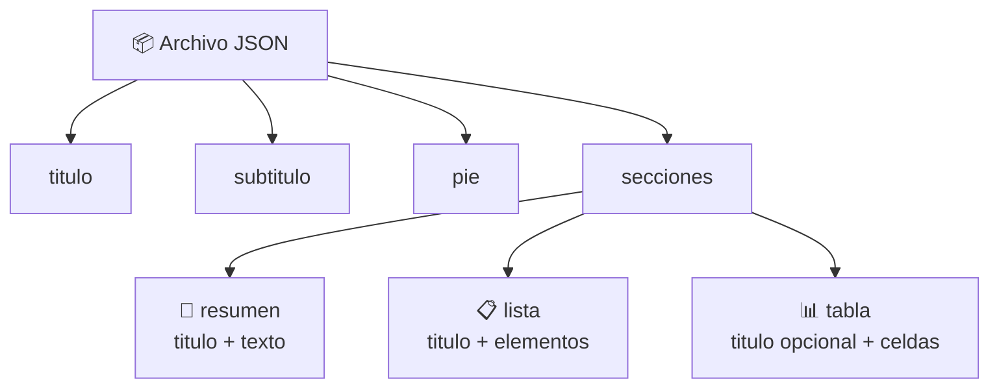

# 📋 Esquema del JSON de entrada

Este documento describe el archivo JSON que lee **Maquetador de contenido** para armar una infografía o una presentación.

```
maquetador_contenido infografia   <diseño> <entrada.json> <salida.html>
maquetador_contenido presentacion <diseño> <entrada.json> <salida.html>
```

El mismo archivo sirve para los dos comandos. Los nombres de los diseños salen de `maquetador_contenido listar`.

---

## 🧱 Estructura general



Todas las claves van en español y en minúsculas.

---

## 🔑 Claves de la raíz

| Clave | Tipo | ¿Obligatoria? | Para qué sirve |
| --- | --- | --- | --- |
| `titulo` | texto | recomendada | Título del documento y de la portada |
| `subtitulo` | texto | no | Texto que acompaña al título |
| `pie` | texto | no | Pie de la infografía. **Las presentaciones no lo usan** |
| `secciones` | lista de secciones | recomendada | El contenido, en el orden en que aparece |

- Si falta `titulo` o `subtitulo`, se usa un texto vacío; no se produce ningún error.
- Si falta `secciones`, el resultado es una pieza sin contenido.
- Las claves que no están en la tabla se ignoran.

---

## 📑 Secciones

Cada sección es un objeto con la clave `tipo`. Hay tres tipos.

### 📝 `resumen`

Un título con un párrafo.

| Clave | Tipo | ¿Obligatoria? |
| --- | --- | --- |
| `tipo` | `"resumen"` | sí |
| `titulo` | texto | sí |
| `texto` | texto | sí |

```json
{ "tipo": "resumen", "titulo": "Contexto", "texto": "Texto del contexto." }
```

### 📋 `lista`

Un título con una lista de puntos, con subpuntos opcionales.

| Clave | Tipo | ¿Obligatoria? |
| --- | --- | --- |
| `tipo` | `"lista"` | sí |
| `titulo` | texto | sí |
| `elementos` | lista de textos, con sublistas opcionales | sí |

Cada texto es un punto. Una sublista que aparece **justo después** de un texto contiene los subpuntos de ese punto:

```json
{
  "tipo": "lista",
  "titulo": "Puntos",
  "elementos": ["Uno", ["Sub uno", "Sub dos"], "Dos"]
}
```

Aquí `Uno` tiene dos subpuntos y `Dos` no tiene ninguno. Una sublista al inicio, sin un punto antes, se ignora. Se recomienda un solo nivel de subpuntos. Los valores que no son texto ni lista, como números u objetos, se ignoran.

### 📊 `tabla`

Una tabla armada con coordenadas tipo hoja de cálculo.

| Clave | Tipo | ¿Obligatoria? |
| --- | --- | --- |
| `tipo` | `"tabla"` | sí |
| `titulo` | texto | no |
| `celdas` | objeto de coordenada a valor | sí |

Cada clave de `celdas` es una coordenada: **letras de columna** (`A`, `B`, … `Z`, `AA`, …) y **número de fila** (desde `1`).

```json
{
  "tipo": "tabla",
  "titulo": "Datos",
  "celdas": { "A1": "Nombre", "B1": "Valor", "A2": "x", "B2": "1" }
}
```

- El tamaño de la tabla lo da la coordenada más lejana. Las celdas que no se escriben quedan vacías.
- Los valores que no son texto, como números, se convierten a texto.
- Las letras de la coordenada pueden ir en mayúscula o minúscula.

---

## ⚠️ Qué pasa con lo incompleto

El maquetador **no marca error** cuando una sección está incompleta: la omite sin avisar.

| Situación | Resultado |
| --- | --- |
| `resumen` o `lista` sin `titulo` | La sección no aparece |
| `resumen` sin `texto` o `lista` sin `elementos` | La sección no aparece |
| `tabla` sin `celdas` | La sección no aparece |
| `tipo` ausente o desconocido | La sección no aparece |

Los únicos errores son que el archivo no exista o que no sea un JSON válido; el programa termina con código 1 y un mensaje en español.

---

## 🖼️ Qué muestra cada tipo de pieza

| Sección | Infografía | Presentación |
| --- | --- | --- |
| `resumen` | ✅ | ✅ una lámina |
| `lista` | ✅ | ✅ una lámina |
| `tabla` | ✅ | ❌ no se muestra |

La presentación siempre empieza con una **portada** hecha con `titulo` y `subtitulo`, y después una lámina por cada sección de `resumen` o `lista`.

---

## 🧩 Clave opcional: `figura`

Cualquier sección acepta `figura`: un texto con el dibujo (por ejemplo un SVG) que se coloca como adorno junto a la sección. Se inserta tal cual, sin revisarlo.

Desde la línea de comandos **no está activada la hoja de estilos que acomoda estas figuras**, así que no está pensada para usarse por ahí. No la probé visualmente.

---

## 🧪 Ejemplo completo

```json
{
  "titulo": "Reforma educativa",
  "subtitulo": "Resumen del periodo",
  "pie": "Fuente de prueba",
  "secciones": [
    { "tipo": "resumen", "titulo": "Contexto", "texto": "Texto del contexto." },
    {
      "tipo": "lista",
      "titulo": "Puntos",
      "elementos": ["Uno", ["Sub uno"], "Dos"]
    },
    {
      "tipo": "tabla",
      "titulo": "Datos",
      "celdas": { "A1": "Nombre", "B1": "Valor", "A2": "x", "B2": "1" }
    }
  ]
}
```

Este ejemplo se probó contra los 133 diseños del catálogo.

---

## 📐 Esquema formal (JSON Schema)

Para validar un archivo con una herramienta automática. Describe lo que el programa entiende; el programa en sí es más tolerante y omite lo incompleto.

```json
{
  "$schema": "https://json-schema.org/draft/2020-12/schema",
  "title": "Entrada de Maquetador de contenido",
  "type": "object",
  "properties": {
    "titulo": { "type": "string" },
    "subtitulo": { "type": "string" },
    "pie": { "type": "string" },
    "secciones": {
      "type": "array",
      "items": {
        "oneOf": [
          {
            "type": "object",
            "properties": {
              "tipo": { "const": "resumen" },
              "titulo": { "type": "string" },
              "texto": { "type": "string" },
              "figura": { "type": "string" }
            },
            "required": ["tipo", "titulo", "texto"]
          },
          {
            "type": "object",
            "properties": {
              "tipo": { "const": "lista" },
              "titulo": { "type": "string" },
              "elementos": {
                "type": "array",
                "items": {
                  "oneOf": [
                    { "type": "string" },
                    { "type": "array", "items": { "type": "string" } }
                  ]
                }
              },
              "figura": { "type": "string" }
            },
            "required": ["tipo", "titulo", "elementos"]
          },
          {
            "type": "object",
            "properties": {
              "tipo": { "const": "tabla" },
              "titulo": { "type": "string" },
              "celdas": {
                "type": "object",
                "propertyNames": { "pattern": "^[A-Za-z]+[0-9]+$" },
                "additionalProperties": { "type": ["string", "number"] }
              },
              "figura": { "type": "string" }
            },
            "required": ["tipo", "celdas"]
          }
        ]
      }
    }
  }
}
```
