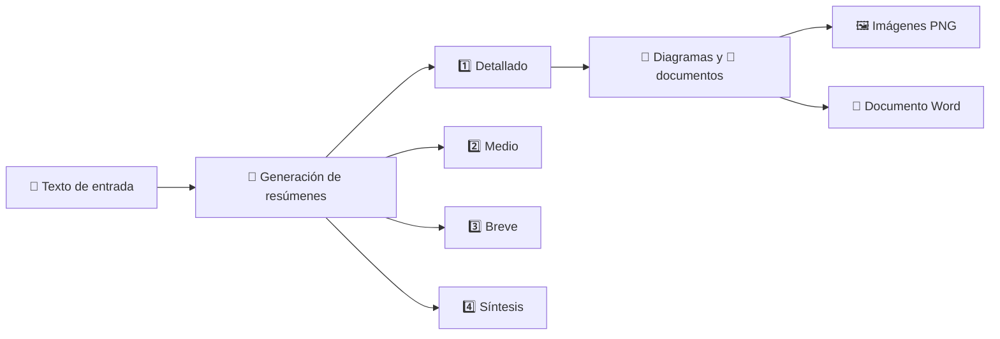

<div align="center">

# 🐨 Koala Cowork

### El koala que no suelta el texto hasta exprimirlo

De un texto largo a **4 niveles de resumen**, **17 diagramas PNG** y **documentos Word**. Todo con una sola herramienta, desde tu **línea de comandos** o por su **API HTTP**. 🚀


</div>

> 🐨 **Koala Cowork** es tu compañero de trabajo: se sube al árbol del texto, lo recorre completo y no baja hasta dejar el paquete servido. Lento con calma, prolijo con el resultado.

## 🧬 La marca

| Elemento | Qué representa |
| --- | --- |
| 🐨 **Koala** | Trabajo paciente y completo: el texto se lee entero y nunca se pierde la mitad del camino |
| 🤝 **Cowork** | Trabaja contigo: tú le das el texto y él entrega el paquete completo |
| 🧾 **Paquete completo** | Un texto entra, sale resumen + 17 diagramas + documento Word |
| 🗣️ **Voz de marca** | Español claro, cercano y sin jerga; las cifras y fechas se conservan tal cual |

## ✨ ¿Qué hace?

1. 📄 Le das un texto
2. 🧠 Te devuelve el resumen en **4 niveles de detalle**, en texto
3. 🎨 Lo entrega también como **17 diagramas** en imágenes PNG, a partir del nivel más detallado
4. 📄 Y como un **documento Word** con una tabla de análisis

Se usa desde la **línea de comandos** o desde la **API HTTP** para que lo consuma otra aplicación. 🤖

## 📚 Los 4 niveles de resumen

| Nivel | ¿Qué contiene? |
|-------|----------------|
| 1️⃣ Detallado | Toda la información importante del texto |
| 2️⃣ Medio | Lo esencial, a mitad de extensión |
| 3️⃣ Breve | Solo las ideas principales |
| 4️⃣ Síntesis | Una sola oración con el corazón del texto |

Los diagramas y documentos se crean a partir del nivel más completo, así conservan toda la riqueza del contenido. 💡

## 📦 Formatos de salida

| Formato | Qué entrega | Cómo se obtiene |
|---------|-------------|-----------------|
| 📝 Texto | Los 4 niveles (detallado → síntesis) | Pantalla con `summarize` o `POST /resumen` |
| 🖼️ Imagen PNG | Los 17 diagramas | Archivos en `diagramas/` o `POST /diagrama` |
| 📄 Word DOCX | La tabla de análisis | Archivo en `documentos/` o `POST /documento` |

## 🎨 Los 17 diagramas

| Diagrama | Tipo interno | Ideal para... |
|----------|--------------|---------------|
| 🐟 Ishikawa | `ishikawa` | Analizar causas de un problema |
| ⭕ Venn | `venn` | Comparar conceptos y sus coincidencias |
| 🌳 Cuadro sinóptico | `cuadro-sinoptico` | Ver la estructura de un tema de un vistazo |
| 🗺️ Mapa conceptual | `mapa-conceptual` | Entender cómo se relacionan las ideas |
| ➡️ Flujo | `flujo` | Seguir una secuencia de pasos |
| 🌲 Árbol | `arbol` | Ver jerarquías y ramificaciones |
| 📅 Pert | `pert` | Planificar tareas y sus dependencias |
| 📊 Gantt | `gantt` | Visualizar tiempos y duraciones |
| 🕸️ Radar | `radar` | Comparar varios criterios a la vez |
| 🔥 Mapa de calor | `mapa-calor` | Matriz de riesgos: probabilidad vs impacto |
| 📈 Tendencia | `tendencia` | Ver la evolución de una o varias series |
| 📉 Pareto | `pareto` | Priorizar causas con la regla 80/20 |
| 🔀 Flujo de proceso | `flujo-proceso` | Procesos con decisiones y ramas |
| 🌿 Árbol de decisión | `arbol-decision` | Preguntas, alternativas y resultados |
| 🔄 Flujo de actualización | `flujo-actualizacion` | Fases de una actualización y su estado |
| 🏭 SIPOC | `sipoc` | Ver proveedores, entradas, proceso, salidas y clientes |
| ⚙️ Mapa de flujo de valor | `mapa-flujo-valor` | Medir valor y desperdicio a lo largo del proceso |

## 📄 Los documentos

| Documento | Tipo interno | Ideal para... |
|-----------|--------------|---------------|
| 🗂️ Tabla de análisis de cambios | `tabla-cambios` | Comparar antes/después, impacto y responsables |

Se generan como archivo `.docx` con la librería [`docx`](https://www.npmjs.com/package/docx): título, tabla con encabezado resaltado y una fila por registro.

## 🔄 ¿Cómo funciona por dentro?

### El camino del texto 🛤️



Cada nivel se crea leyendo **el texto completo**, solo cambia el grado de condensación que se pide. Si el texto es muy extenso, se procesa por partes sin perder ni una pieza. 🧩

### Los agentes 🤖

| Agente | Responsabilidad |
|--------|-----------------|
| 🧠 `Resumidor` | Genera los 4 niveles de resumen |
| 🎨 `Diagramador` | Genera los diagramas PNG |
| 📄 `Documentador` | Genera el documento Word |
| 🎛️ `KoalaAgente` | Orquesta el flujo: resumir → generar diagramas → generar documento |

Cada pieza tiene un único trabajo, y el flujo se ejecuta de principio a fin con un solo comando.

## 🔌 La API HTTP

Con `serve` queda disponible la API JSON en el puerto 3000. Todos los cuerpos son JSON; los archivos se devuelven como descarga. 📥

| Endpoint | Cuerpo | Devuelve |
|----------|--------|----------|
| 📝 `POST /resumen` | `texto`, `nivel` (1–4, opcional) | `{ nivel, resumen }` |
| 📦 `POST /api/procesar` | `texto`, `nivel` (opcional), `conDiagramas` (opcional) | `{ niveles, archivos }` |
| 🖼️ `POST /diagrama` | `tipo`, `texto` | El PNG como descarga |
| 📄 `POST /documento` | `tipo`, `texto` | El DOCX como descarga |
| 🚀 `POST /ejecutar` | `texto`, `conDiagramas` (opcional) | `{ niveles, archivos }` del flujo completo |
| 📥 `GET /download/*ruta` | — | Un archivo generado del proyecto |

También hay endpoints de conversaciones: `GET`/`POST /api/conversaciones`, `GET`/`PATCH`/`DELETE /api/conversaciones/:id` y `POST /api/conversaciones/:id/mensajes`.

## 🚀 Empezar

> 🐨 En **dos pasos**: configura el proveedor y deja que el koala resuma.

### 1️⃣ Configura tu proveedor

**🌐 Con OpenRouter:**

```bash
bun index.ts config --provider openrouter --key TU_API_KEY --model openai/gpt-4o-mini
```

**🖥️ Con cualquier servicio compatible con OpenAI:**

```bash
bun index.ts config --provider openai --url http://localhost:1234/v1 --key TU_API_KEY --model gpt-4o-mini
```

La configuración queda guardada en tu equipo (carpeta `.secti_addons` de tu usuario) y solo necesitas hacerla una vez. Si existe `~/.oselotl/providers.json`, se toma de ahí. 💾

### 2️⃣ Resume, diagrama y documenta

```bash
bun index.ts summarize "Aquí va el texto que quieres resumir..."
```

Verás los 4 niveles en pantalla, las **17 imágenes** en `diagramas/` y la **tabla Word** en `documentos/`. 📁

## 🖥️ La línea de comandos

El programa tiene tres comandos: `config` (⚙️ configurar), `summarize` (📝 resumir) y `serve` (🔌 servidor HTTP).

### ⚙️ `config` — preparar tu proveedor

```bash
bun index.ts config --provider <openrouter|openai> [--url <url>] [--key <apikey>] [--model <modelo>]
```

| Opción | ¿Qué es? | ¿Cuándo se usa? |
|--------|----------|-----------------|
| `--provider` | 🌐 `openrouter` o 🖥️ `openai` | Siempre (elige el tipo de servicio) |
| `--url` | 🔗 Dirección del servicio | Solo con `openai` (por ejemplo `http://localhost:1234/v1`) |
| `--key` | 🔑 Tu clave de API | La primera vez, o para cambiarla |
| `--model` | 🧠 Modelo a utilizar | La primera vez, o para cambiarlo |

💡 Lo que no indiques se conserva de la configuración anterior, así que puedes actualizar solo una parte.

### 📝 `summarize` — resumir, diagramar y documentar

```bash
bun index.ts summarize "texto que quieres resumir"
```

En pantalla verás los 4 niveles 🧠 y, después, las rutas de los 17 PNG en `diagramas/` 🖼️ y del documento en `documentos/` 📄.

| Opción | ¿Qué hace? |
|--------|-----------|
| `--solo-resumen` | ✂️ Genera solo los 4 niveles, sin archivos |
| `--diagramas <dir>` | 📁 Cambia el directorio de los PNG |
| `--documentos <dir>` | 📁 Cambia el directorio de los DOCX |

```bash
bun index.ts summarize --solo-resumen "texto que quieres resumir"
```

### 🔌 `serve` — servidor HTTP del agente

```bash
bun index.ts serve [--puerto <puerto>]
```

Arranca un servidor Express con los endpoints del agente (puerto 3000 por defecto). 📥

### 🧭 Si te pierdes

Ejecuta el programa sin comandos y te mostrará cómo se usa:

```bash
bun index.ts
```

### 🏗️ Compilar el ejecutable

```bash
bun run build
```

Deja `dist/koala-cowork.exe` y copia a su lado `dist/icudtl.dat`, los datos que la librería de dibujo lee del disco para escribir texto: sin ese archivo, los diagramas fallan dentro del ejecutable. 🧷

Con el ejecutable compilado los comandos son los mismos, sin `bun index.ts`:

```bash
./dist/koala-cowork.exe summarize "texto que quieres resumir"
```

## 🧪 Smoke test

Comprueba que todo funciona sin gastar créditos del modelo: levanta un mock local de la API, renderiza los 17 diagramas y el documento, y prueba el binario compilado.

Si existe `dist/koala-cowork.exe`, el CLI se prueba **con el ejecutable compilado** (`exe uso` y `exe summarize`); si no, se usa `bun index.ts`. La configuración del usuario se respalda en `debug/smoke-config-previo.json` y se restaura al terminar (también si cortas con Ctrl+C). ⛑️

```bash
bun debug/smoke.ts
```

Los resultados quedan en `debug/`:

| Archivo | Contenido |
|---------|-----------|
| `debug/smoke.log` | Resumen legible paso a paso |
| `debug/smoke.json` | Resultados estructurados |
| `debug/smoke-<tipo>.png` / `.docx` | Archivos generados por el render |

## ⚙️ Cambiar de proveedor o modelo

Vuelve a ejecutar `config` con los nuevos valores. Lo que no indiques se conserva de la configuración anterior, así que puedes cambiar solo el modelo sin reescribir todo. 🔄

```bash
bun index.ts config --provider openrouter --model anthropic/claude-3.5-sonnet
```

## 🏷️ Koala Cowork en una línea

> **Koala Cowork** 🐨 — *el resumidor que no suelta el texto hasta entregarte el paquete completo: 4 niveles, 17 diagramas y documentos Word.*

Si tienes que presentarlo en algún lado, con eso basta. 📣

## 📁 Dónde queda todo

| Elemento | Ubicación |
|----------|-----------|
| ⚙️ Configuración | `~/.secti_addons/modelr.json` |
| 🖼️ Diagramas | Carpeta `diagramas/` del proyecto (con `--solo-resumen` no se generan) |
| 📄 Documentos | Carpeta `documentos/` del proyecto (con `--solo-resumen` no se generan) |
| 🧪 Resultados del smoke test | Carpeta `debug/` |

Los nombres de archivo usan el tipo interno, así que un diagrama de Ishikawa queda en `diagramas/ishikawa.png` y la tabla de cambios en `documentos/tabla-cambios.docx`. 📂

---

<div align="center">

### 🐨 Koala Cowork

*Lee completo. Resume claro. Entrega todo.*

Hecho con 💙 por **Edahi Yaxquin Avila Garcia**

</div>
