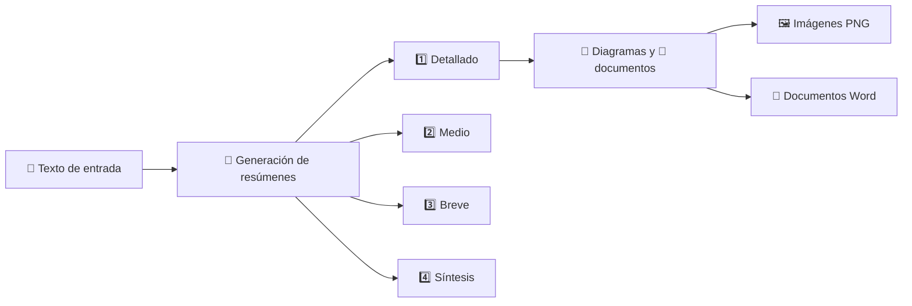

# 📝 Resumidor de Textos con Diagramas

Convierte cualquier texto largo en **4 niveles de resumen** y lo entrega en **varios formatos**: texto, **imágenes PNG** y **documentos Word**. 🚀

## ✨ ¿Qué hace?

1. 📄 Le das un texto
2. 🧠 Te devuelve el resumen en **4 niveles de detalle**, en texto
3. 🎨 Lo entrega también como **15 diagramas** en imágenes PNG a partir del nivel más detallado
4. 📄 Y como **documentos Word** (tablas) con la misma información

Todo se puede usar desde la **línea de comandos** o como **servidor MCP** para que lo consuma un agente externo. 🤖

## 📚 Los 4 niveles de resumen

| Nivel | ¿Qué contiene? |
|-------|----------------|
| 1️⃣ Detallado | Toda la información importante del texto |
| 2️⃣ Medio | Lo esencial, a mitad de extensión |
| 3️⃣ Breve | Solo las ideas principales |
| 4️⃣ Síntesis | Una sola oración con el corazón del texto |

Los diagramas y documentos se crean a partir del nivel más completo, así conservan toda la riqueza del contenido. 💡

## 📦 Formatos de salida

El resumen no se queda en texto: sale en tres formatos. 📤

| Formato | Qué entrega | Cómo se obtiene |
|---------|-------------|-----------------|
| 📝 Texto | Los 4 niveles (detallado → síntesis) | Pantalla con `summarize` o herramienta MCP `resumir` |
| 🖼️ Imagen PNG | Los 15 diagramas | Archivos en `diagramas/` o herramientas `diagrama_<tipo>` |
| 📄 Word DOCX | Las tablas de análisis | Archivo en `documentos/` o herramienta `documento_<tipo>` |

Por MCP, los archivos vuelven **embebidos en base64** (imagen o recurso), así el agente que consulta recibe el contenido sin depender del disco. 🔐

## 🎨 Los 15 diagramas

| Diagrama | Tipo interno | Ideal para... |
|----------|--------------|---------------|
| 🐟 Ishikawa | `ishikawa` | Analizar causas de un problema |
| ⭕ Venn | `venn` | Comparar conceptos y sus coincidencias |
| 🌳 Cuadro sinóptico | `cuadro-sinoptico` | Ver la estructura de un tema de un vistazo |
| 🗺️ Mapa conceptual | `mapa-conceptual` | Entender cómo se relacionan las ideas |
| ➡️ Flujo | `flujo` | Seguir una secuencia de pasos |
| 🌲 Árbol | `arbol` | Ver jerarquías y ramificaciones |
| 📅 Pert | `pert` | Planificar tareas y sus dependencias |
| 📊 Gantt | `gantt` | Visualizar tiempos y duraciones |
| 🕸️ Radar | `radar` | Comparar varios criterios a la vez |
| 🔥 Mapa de calor | `mapa-calor` | Matriz de riesgos: probabilidad vs impacto |
| 📈 Tendencia | `tendencia` | Ver la evolución de una o varias series |
| 📉 Pareto | `pareto` | Priorizar causas con la regla 80/20 |
| 🔀 Flujo de proceso | `flujo-proceso` | Procesos con decisiones y ramas |
| 🌿 Árbol de decisión | `arbol-decision` | Preguntas, alternativas y resultados |
| 🔄 Flujo de actualización | `flujo-actualizacion` | Fases de una actualización y su estado |

## 📄 Los documentos

| Documento | Tipo interno | Ideal para... |
|-----------|--------------|---------------|
| 🗂️ Tabla de análisis de cambios | `tabla-cambios` | Comparar antes/después, impacto y responsables |

Se generan como archivo `.docx` con la librería [`docx`](https://www.npmjs.com/package/docx): título, tabla con encabezado resaltado y una fila por registro.

## 🔄 ¿Cómo funciona por dentro?

### El camino del texto 🛤️



Cada nivel se crea leyendo **el texto completo**, solo cambia el grado de condensación que se pide. Si el texto es muy extenso, se procesa por partes sin perder ni una pieza. 🧩

### Los agentes 🤖

| Agente | Responsabilidad |
|--------|-----------------|
| 🧠 `Resumidor` | Genera los 4 niveles |
| 🎨 `Diagramador` | Genera los diagramas PNG |
| 📄 `Documentador` | Genera los documentos Word |
| 🎛️ `AgenteResumen` | Orquesta el flujo: resumir → diagramar → documentar |

Cada pieza tiene un único trabajo, y el flujo se ejecuta de principio a fin con un solo comando.

## 🚀 Empezar

### 1️⃣ Configura tu proveedor

**🌐 Con OpenRouter:**

```bash
bun index.ts config --provider openrouter --key TU_API_KEY --model openai/gpt-4o-mini
```

**🖥️ Con cualquier servicio compatible con OpenAI:**

```bash
bun index.ts config --provider openai --url http://localhost:1234/v1 --key TU_API_KEY --model gpt-4o-mini
```

La configuración queda guardada en tu equipo (carpeta `.secti_addons` de tu usuario) y solo necesitas hacerla una vez. 💾

### 2️⃣ Resume, diagrama y documenta

```bash
bun index.ts summarize "Aquí va el texto que quieres resumir..."
```

Verás los 4 niveles en pantalla, las **15 imágenes** en `diagramas/` y la **tabla Word** en `documentos/`. 📁

### 3️⃣ (Opcional) Úsalo como servidor MCP

```bash
bun index.ts mcp
```

Habla **MCP sobre stdio**, así que cualquier cliente compatible puede lanzarlo y usar sus herramientas. Por ejemplo:

```json
{
  "mcpServers": {
    "resumidor-texto": {
      "command": "bun",
      "args": ["index.ts", "mcp"],
      "cwd": "/ruta/a/resumidor_texto"
    }
  }
}
```

## 🔌 Herramientas MCP

| Herramienta | Argumentos | Devuelve |
|-------------|------------|----------|
| 🧠 `resumir` | `texto`, `nivel` (1–4) | El resumen del nivel pedido |
| 🎨 `diagrama_<tipo>` | `texto` | Ruta + imagen PNG en **base64** |
| 📄 `documento_<tipo>` | `texto` | Ruta + DOCX en **base64** como recurso |

Los nombres usan guiones bajos: `ishikawa` → `diagrama_ishikawa`, `cuadro-sinoptico` → `diagrama_cuadro_sinoptico`, `tabla-cambios` → `documento_tabla_cambios`. 🔤

Cada herramienta hace **una sola llamada al modelo** para el tipo pedido, así que no necesitas generar todo el paquete si solo quieres un diagrama. ⚡

## 🖥️ La línea de comandos

El programa tiene tres comandos: `config` (⚙️ configurar), `summarize` (📝 resumir) y `mcp` (🔌 servidor).

### ⚙️ `config` — preparar tu proveedor

```bash
bun index.ts config --provider <openrouter|openai> [--url <url>] [--key <apikey>] [--model <modelo>]
```

| Opción | ¿Qué es? | ¿Cuándo se usa? |
|--------|----------|-----------------|
| `--provider` | 🌐 `openrouter` o 🖥️ `openai` | Siempre (elige el tipo de servicio) |
| `--url` | 🔗 Dirección del servicio | Solo con `openai` (por ejemplo `http://localhost:1234/v1`) |
| `--key` | 🔑 Tu clave de API | La primera vez, o para cambiarla |
| `--model` | 🧠 Modelo a utilizar | La primera vez, o para cambiarlo |

💡 Lo que no indiques se conserva de la configuración anterior, así que puedes actualizar solo una parte.

### 📝 `summarize` — resumir, diagramar y documentar

```bash
bun index.ts summarize "texto que quieres resumir"
```

En pantalla verás los 4 niveles 🧠 y, después, las rutas de los 15 PNG en `diagramas/` 🖼️ y del documento en `documentos/` 📄.

¿Solo quieres el resumen sin archivos? Añade la opción `--solo-resumen` ✂️:

```bash
bun index.ts summarize --solo-resumen "texto que quieres resumir"
```

### 🔌 `mcp` — servidor para agentes

```bash
bun index.ts mcp
```

Arranca el servidor MCP sobre stdio. No imprime nada: espera peticiones del cliente que lo lanzó. 🤐

### 🧭 Si te pierdes

Ejecuta el programa sin comandos y te mostrará cómo se usa:

```bash
bun index.ts
```

## 🧪 Smoke test

Comprueba que todo funciona sin gastar créditos del modelo: levanta un mock local de la API, renderiza los 15 diagramas y el documento, y valida el servidor MCP (tools, resumen y adjuntos en base64).

```bash
bun debug/smoke.ts
```

Los resultados quedan en `debug/`:

| Archivo | Contenido |
|---------|-----------|
| `debug/smoke.log` | Resumen legible paso a paso |
| `debug/smoke.json` | Resultados estructurados |
| `debug/smoke-<tipo>.png` / `.docx` | Archivos generados por el render |
| `debug/smoke-mcp-*.png` / `.docx` | Adjuntos devueltos por el MCP |

## ⚙️ Cambiar de proveedor o modelo

Vuelve a ejecutar `config` con los nuevos valores. Lo que no indiques se conserva de la configuración anterior, así que puedes cambiar solo el modelo sin reescribir todo. 🔄

```bash
bun index.ts config --provider openrouter --model anthropic/claude-3.5-sonnet
```

## 📁 Dónde queda todo

| Elemento | Ubicación |
|----------|-----------|
| ⚙️ Configuración | `~/.secti_addons/modelr.json` |
| 🖼️ Diagramas | Carpeta `diagramas/` del proyecto (con `--solo-resumen` no se generan) |
| 📄 Documentos | Carpeta `documentos/` del proyecto (con `--solo-resumen` no se generan) |
| 🧪 Resultados del smoke test | Carpeta `debug/` |

Los nombres de archivo usan el tipo interno, así que un diagrama de Ishikawa queda en `diagramas/ishikawa.png` y la tabla de cambios en `documentos/tabla-cambios.docx`. 📂
