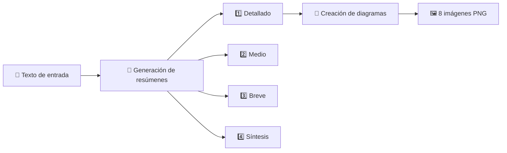
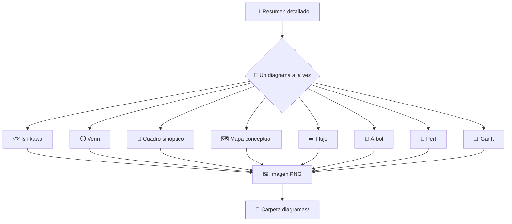

# 📝 Resumidor de Textos con Diagramas

Convierte cualquier texto largo en **4 niveles de resumen** y **8 diagramas visuales** listos para usar. 🚀

## ✨ ¿Qué hace?

1. 📄 Le das un texto
2. 🧠 Te devuelve el resumen en **4 niveles de detalle**
3. 🎨 Genera **8 diagramas** como imágenes PNG a partir del resumen

## 📚 Los 4 niveles de resumen

| Nivel | ¿Qué contiene? |
|-------|----------------|
| 1️⃣ Detallado | Toda la información importante del texto |
| 2️⃣ Medio | Lo esencial, a mitad de extensión |
| 3️⃣ Breve | Solo las ideas principales |
| 4️⃣ Síntesis | Una sola oración con el corazón del texto |

Los diagramas se crean a partir del nivel más completo, así conservan toda la riqueza del contenido. 💡

## 🎨 Los 8 diagramas

| Diagrama | Ideal para... |
|----------|---------------|
| 🐟 Ishikawa | Analizar causas de un problema |
| ⭕ Venn | Comparar conceptos y sus coincidencias |
| 🌳 Cuadro sinóptico | Ver la estructura de un tema de un vistazo |
| 🗺️ Mapa conceptual | Entender cómo se relacionan las ideas |
| ➡️ Flujo | Seguir una secuencia de pasos |
| 🌲 Árbol | Ver jerarquías y ramificaciones |
| 📅 Pert | Planificar tareas y sus dependencias |
| 📊 Gantt | Visualizar tiempos y duraciones |

## 🔄 ¿Cómo funciona por dentro?

### El camino del texto 🛤️



Cada nivel se crea leyendo **el texto completo**, solo cambia el grado de condensación que se pide. Si el texto es muy extenso, se procesa por partes sin perder ni una pieza. 🧩

### El ciclo de los diagramas 🔁



## 🚀 Empezar

### 1️⃣ Configura tu proveedor

**🌐 Con OpenRouter:**

```bash
bun index.ts config --provider openrouter --key TU_API_KEY --model openai/gpt-4o-mini
```

**🖥️ Con cualquier servicio compatible con OpenAI:**

```bash
bun index.ts config --provider openai --url http://localhost:1234/v1 --key TU_API_KEY --model gpt-4o-mini
```

La configuración queda guardada en tu equipo (carpeta `.secti_addons` de tu usuario) y solo necesitas hacerla una vez. 💾

También puedes usar la variable de entorno `OPENROUTER_API_KEY` si prefieres no guardar la clave en el archivo. 🔐

### 2️⃣ Resume y genera diagramas

```bash
bun index.ts summarize "Aquí va el texto que quieres resumir..."
```

Verás los 4 niveles de resumen en pantalla y las 8 imágenes se guardarán en la carpeta `diagramas/`. 📁

## 🖥️ La línea de comandos

El programa tiene dos comandos: `config` (⚙️ configurar) y `summarize` (📝 resumir).

### ⚙️ `config` — preparar tu proveedor

```bash
bun index.ts config --provider <openrouter|openai> [--url <url>] [--key <apikey>] [--model <modelo>]
```

| Opción | ¿Qué es? | ¿Cuándo se usa? |
|--------|----------|-----------------|
| `--provider` | 🌐 `openrouter` o 🖥️ `openai` | Siempre (elige el tipo de servicio) |
| `--url` | 🔗 Dirección del servicio | Solo con `openai` (por ejemplo `http://localhost:1234/v1`) |
| `--key` | 🔑 Tu clave de API | La primera vez, o para cambiarla |
| `--model` | 🧠 Modelo a utilizar | La primera vez, o para cambiarlo |

💡 Lo que no indiques se conserva de la configuración anterior, así que puedes actualizar solo una parte.

### 📝 `summarize` — resumir y crear diagramas

```bash
bun index.ts summarize "texto que quieres resumir"
```

En pantalla verás los 4 niveles de resumen 🧠 y, después, las 8 imágenes del diagrama guardadas en `diagramas/` 🖼️.

¿Solo quieres el resumen sin diagramas? Añade la opción `--solo-resumen` ✂️:

```bash
bun index.ts summarize --solo-resumen "texto que quieres resumir"
```

### 🧭 Si te pierdes

Ejecuta el programa sin comandos y te mostrará cómo se usa:

```bash
bun index.ts
```

## ⚙️ Cambiar de proveedor o modelo

Vuelve a ejecutar `config` con los nuevos valores. Lo que no indiques se conserva de la configuración anterior, así que puedes cambiar solo el modelo sin reescribir todo. 🔄

```bash
bun index.ts config --provider openrouter --model anthropic/claude-3.5-sonnet
```

## 📁 Dónde queda todo

| Elemento | Ubicación |
|----------|-----------|
| ⚙️ Configuración | `~/.secti_addons/modelr.json` |
| 🖼️ Diagramas | Carpeta `diagramas/` del proyecto (con `--solo-resumen` no se generan) |
